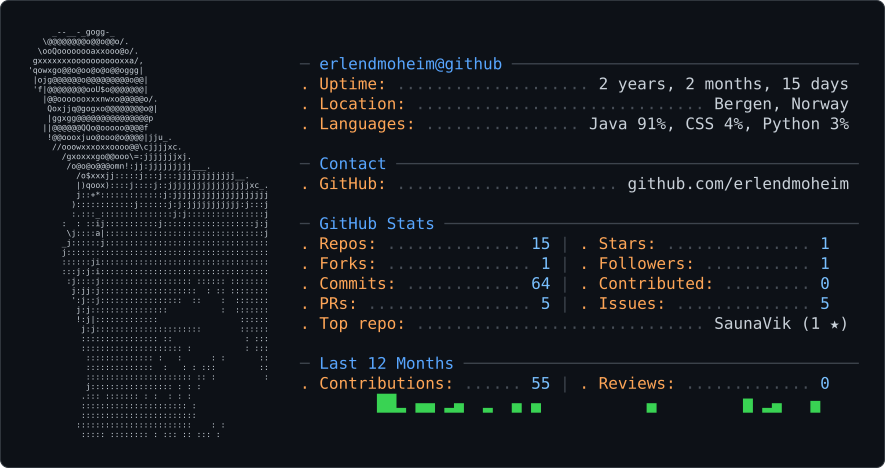

<picture>
  <source media="(prefers-color-scheme: dark)" srcset="dark_mode.svg">
  <source media="(prefers-color-scheme: light)" srcset="light_mode.svg">
  
</picture>

# Erlend Moheim

I'm a Computer Engineering student at HVL (Western Norway University of Applied Sciences), based in Bergen and graduating in June 2027. I'm interested in software development, practical AI and cloud systems.

## Background

At HVL, I've worked with Java, SQL/JPA, distributed systems and networking. My 2026 exchange at QUT covered cloud APIs, AI agents, asynchronous AWS workflows, defensive networks, security testing, robotics and computer vision.

In Vegdata at Vestland fylkeskommune, my main summer work was updating NVDB road data using Sinus. I also developed internal Visma export and NVDB submission tools.

## Selected projects

- [Vikjasauna](https://github.com/erlendmoheim/SaunaVik): A Java/Spring Boot booking system I built and deployed, used by customers and the owner.
- [Akseptert](https://akseptert.no): My own quotation and customer-acceptance product. I handled UI/UX and sign-in flows, guided AI-assisted implementation and reviewed the product's behaviour.
- Repository Custodian: A Python GitHub assistant integrating Amazon Bedrock, MCP and vector search, with source-referenced answers and background workflows.
- ResizeFlow: Asynchronous image processing with S3, SQS, Lambda, DynamoDB and Docker workers on ECS Fargate, including queue-based scaling and retries.

[LinkedIn](https://www.linkedin.com/in/erlend-moheim-199925198/)
