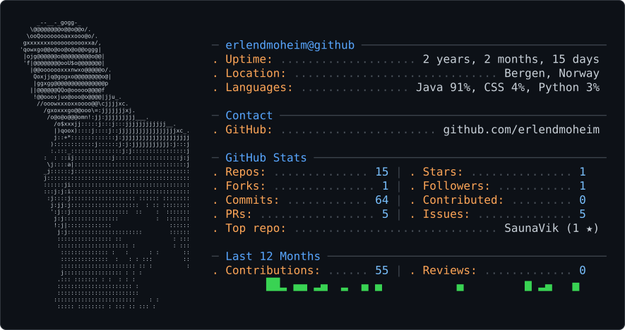

<picture>
  <source media="(prefers-color-scheme: dark)" srcset="dark_mode.svg">
  <source media="(prefers-color-scheme: light)" srcset="light_mode.svg">
  
</picture>

# Erlend Moheim

Computer Engineering student at Western Norway University of Applied Sciences (HVL) in Bergen, graduating in June 2027. I build software in Java and Python and have worked with AWS and network security during an exchange at QUT in Australia.

As a summer employee in Vegdata at Vestland fylkeskommune, I updated road data and built internal tools for Visma exports and submissions to the Norwegian National Road Database (NVDB).

## Projects

- [Vikjasauna](https://github.com/erlendmoheim/SaunaVik). I built and deployed a Java/Spring Boot booking system used by customers and the owner. It handles capacity, closures and Telegram notifications.
- [Akseptert](https://akseptert.no/demo). A quotation tool I developed for tradespeople. It turns site notes into editable AI drafts and gives customers a link to review and accept a quote. Built with Next.js, TypeScript and Supabase.
- **ResizeFlow** · QUT coursework. I built an AWS image-resizing service with SQS and ECS Fargate workers that scaled with queue depth. All 90 jobs submitted over a 15-minute load test completed.
- **Repository Custodian** · QUT coursework. I extended a GitHub assistant with code search, source references and queued issue analysis using Amazon Bedrock, MCP and vector search.
- **Network security** · QUT coursework. I designed and tested a segmented lab network with firewalls, VPN access and centralised detection and alerting.

[LinkedIn](https://www.linkedin.com/in/erlend-moheim-199925198/)
